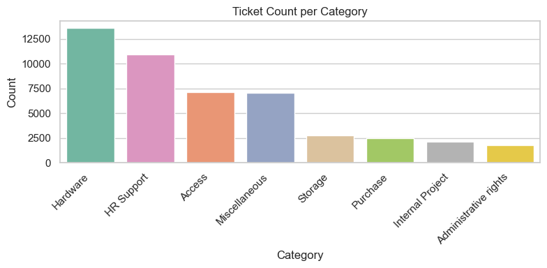
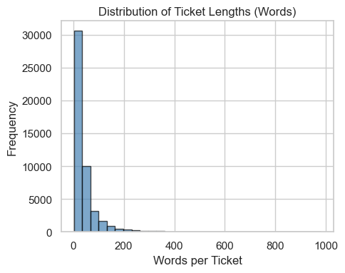
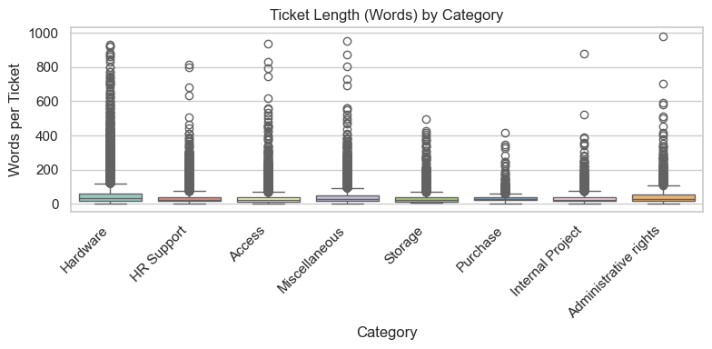

# IT Service Tickets EDA (Python)
Exploratory data analysis of IT service tickets focusing on category imbalance and ticket length patterns using NumPy, Seaborn, and Matplotlib. The goal is to build intuition about the data before modeling and to understand why metrics like median and IQR are often more informative than the mean for text data.

## Context
Before building any model for text classification, I wanted to understand the dataset the same way a data analyst would:  
**What does the data look like, how is it distributed, and what patterns (or problems) show up immediately?**

This project uses an IT service ticket dataset with two main columns:
- **Document** (ticket text)
- **Topic_group** (ticket category)

My focus was on two things that can quietly make or break a classification project:
1. **Class imbalance** (some categories dominate the dataset)
2. **Ticket length behavior** (short vs long tickets, outliers, and overlap by category)

---

## Objective
This analysis is intended as a pre-modeling step to guide feature engineering and evaluation strategy.

Use Python to answer:
- Which categories appear most/least often?
- How imbalanced is the dataset?
- How long are tickets on average (words + characters)?
- Do different categories show different length patterns?
- Why do we sometimes prefer **median + IQR** over **mean** for skewed text-length data?

---

## Tools Used
- **Python**
  - pandas (data handling)
  - NumPy (stats + array work)
- **Visualization**
  - seaborn
  - matplotlib
- **Notebook**
  - Jupyter

---

## What I Did
### 1) Category distribution (counts + %)
- Calculated ticket counts per category
- Converted counts into percentages
- Repeated the same step using **NumPy (`np.unique`)** to practice “no pandas shortcuts”

### 2) Ticket length features
Created two simple but useful features:
- `char_length`: number of characters per ticket
- `word_length`: number of words per ticket

Then computed per-category stats using NumPy:
- mean, median
- standard deviation
- min/max

### 3) Visual checks
Used plots to see patterns fast:
- Category counts (bar chart)
- Word length by category (boxplot)
- Overall word length distribution (histogram)
- Percent per category (normalized bar plot)
- Overlap + distribution shapes (stripplot + violin plot)

---

## Key Findings & Interpretation

### A) The dataset is imbalanced
Some categories have far more tickets than others, meaning:
- A model can look “good” by doing well on big classes while struggling on smaller ones
- Metrics like weighted F1 and per-class recall matter (not just accuracy)
  
  

This chart shows a clear imbalance across categories, with Hardware dominating the dataset and Administrative rights appearing far less frequently.

---

### B) Ticket lengths are skewed (mean can be misleading)
Ticket length behaves like a typical text dataset:
- Most tickets are short/medium
- A small number are extremely long  
That creates a **right tail**, pulling the **mean** upward.

The right-skewed distribution confirms that a small number of extremely long tickets pull the mean upward, making median and IQR more reliable summary statistics.

So instead of relying only on mean, I used:
- **Median** (more stable “typical length”)
- **IQR** (spread of the middle 50% of tickets)

---

### C) Hardware vs Access: Hardware tickets tend to be longer and more variable
I compared two categories: **Hardware** and **Access** using NumPy stats.

The boxplot shows that Hardware tickets have a wider IQR and more extreme outliers than Access tickets, explaining the large gap between mean and median values.

**Hardware**
- Mean ≈ 56.3 words  
- Median = 32 words  
- IQR ≈ 41 words  

**Access**
- Mean ≈ 35.6 words  
- Median = 22 words  
- IQR ≈ 23 words  

**What this suggests**
- Hardware tickets are about **20 words longer on average**
- Hardware also has a **wider IQR**, so length varies more
- The **mean vs median gap** (especially in Hardware) is a sign of **outliers** (very long tickets)

**Why this matters**
If I only used the mean, I’d overestimate what a “typical” ticket looks like.
Median + IQR gives a clearer picture of the usual ticket length and variability.

---

## What I Learned
- NumPy is great for “under the hood” analysis (like class counts and distribution stats)
- In text data, mean length often gets distorted by a handful of long tickets
- Visuals (boxplots/violins/stripplots) make overlap and outliers obvious fast
- Class imbalance is an early warning sign for modeling and evaluation choices later

---

## Next Steps (If I continue this project)
- Add simple text features beyond length:
  - punctuation count, digit count, uppercase ratio
- Compare whether length alone can separate categories (quick baseline)
- Move into modeling:
  - TF-IDF + Linear models (baseline)
  - embeddings-based similarity search
  - transformer-based classifier (if needed)

---

## Dataset

The dataset used in this project was sourced from Kaggle:

**IT Service Ticket Classification Dataset**  
https://www.kaggle.com/datasets/adisongoh/it-service-ticket-classification-dataset/data

The dataset is not included in this repository due to licensing restrictions.  
To reproduce this analysis, download the CSV from Kaggle and place it in the project root directory.

--- 

## Author
**Nii Oye Kpakpo**  
- GitHub: https://github.com/Alucardz18  
- LinkedIn: https://www.linkedin.com/in/nii-oye-kpakpo-5b9997248/  
- Email: nhyirakpakpo@gmail.com
